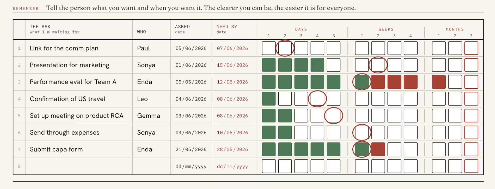

# Thing Tracker

> Tell the person what you want and when you want it. The clearer you can be, the easier it is for everyone.

Thing Tracker is a personal productivity tool for tracking things you've asked other people to do. Instead of losing requests in chat threads or email, you log them in one place — who owes you what, when you asked, and when you need it by — with a visual timeline that shows you at a glance what's on track and what's overdue.



---

## Use Case

You ask a colleague to send you a report. You ask a friend to confirm plans. You ask your team to review a document. These requests scatter across Slack, email, and memory — and things fall through the cracks.

Thing Tracker gives each request a row in a table with:
- **What** you asked for
- **Who** you asked
- **When** you asked
- **When you need it by** — selected visually on a timeline grid
- A color-coded status: green (on track), red (overdue), dashed (done)

You can organize requests into named **trackers** (e.g. Personal, Work, Side Projects) and filter by Open, Closed, or All.

---

## How It Works

### GitHub Issues as a database

Thing Tracker has no backend and no database. Instead, it uses **GitHub Issues** on a repository you control:

- Each request = one GitHub Issue
- The issue **title** = description of the ask
- The issue **labels** = tracker name (`tracker:Work`) and person (`person:Sonya`)
- The issue **body** = structured metadata block containing the due date
- Issue **state** (open/closed) = pending/done
- Issue **created_at** = the date you asked

The due date is stored in the issue body as a hidden comment block:

```
<!-- meta
due: 2026-06-15
-->
```

This keeps the GitHub Issues UI clean while allowing the app to parse metadata on every fetch.

### Label strategy

Two label namespaces are used:

| Label | Purpose |
|---|---|
| `tracker:Personal` | Groups issues into a named tracker |
| `person:Sonya` | Records who was asked |

Labels are created automatically when you first use a tracker or person name.

### Visual timeline grid

Each row displays a grid of 12 cells representing time from the date the request was made:

| Section | Cells | What each cell means |
|---|---|---|
| DAYS | 5 | +1d, +2d, +3d, +4d, +5d from asked date |
| WEEKS | 4 | +1w, +2w, +3w, +4w from asked date |
| MONTHS | 3 | +1m, +2m, +3m from asked date |

**Cell colors:**
- **Green** — time has elapsed, request is still within due date (on track)
- **Red** — time has elapsed, due date has passed (overdue)
- **Empty** — time hasn't elapsed yet (future)
- **Dashed** — request is marked done
- **Circle outline** — marks the due date cell

Clicking any cell on a row sets that cell as the new due date.

### Tech stack

| Layer | Choice |
|---|---|
| Framework | React 18 + Vite |
| Styling | CSS Modules |
| GitHub API | Octokit (`@octokit/rest`) |
| Auth | Personal Access Token stored in `localStorage` |
| Hosting | GitHub Pages (static) |
| CI/CD | GitHub Actions |

---

## Hosting Your Own Instance

### Step 1 — Fork the repository

Click **Fork** on this repository. Your fork will be at:
```
https://github.com/YOUR_USERNAME/thing-tracker
```

### Step 2 — Enable GitHub Pages

1. Go to your fork → **Settings** → **Pages**
2. Under **Source**, select **GitHub Actions**
3. Save

The included workflow (`.github/workflows/deploy.yml`) will automatically build and deploy the app every time you push to `main`.

### Step 3 — Create a Personal Access Token

1. Go to [GitHub Settings → Tokens](https://github.com/settings/tokens/new?scopes=repo)
2. Give it a name (e.g. `thing-tracker`)
3. Select the **`repo`** scope (needed to read/write issues and labels)
4. Click **Generate token** and copy it

> **Keep this token private.** It is stored only in your browser's `localStorage` and is never sent anywhere except the GitHub API.

### Step 4 — Open the app and configure it

Visit your deployed app at:
```
https://YOUR_USERNAME.github.io/thing-tracker/
```

On first load, a setup screen will appear. Enter:
- Your **Personal Access Token**
- Your **GitHub username**
- The **repository name** (e.g. `thing-tracker`)
- Your desired **tracker names** (default: Personal, Work)

Click **Save & continue**. The app verifies access and creates the tracker labels in your repo.

---

## Local Development

### Prerequisites

- Node.js 18+
- npm

### Setup

```bash
git clone https://github.com/YOUR_USERNAME/thing-tracker.git
cd thing-tracker
npm install
npm run dev
```

The app runs at `http://localhost:5173`. On first load, enter your PAT and repo details in the settings screen.

### Build

```bash
npm run build
```

Output goes to `dist/`. To preview the production build locally:

```bash
npm run preview
```

---

## Project Structure

```
thing-tracker/
├── .github/
│   └── workflows/
│       └── deploy.yml          # CI: push to main → build → GitHub Pages
├── src/
│   ├── lib/
│   │   ├── dateUtils.js        # Grid cell math, date formatting
│   │   └── github.js           # Octokit wrapper — issue CRUD, label management
│   ├── hooks/
│   │   ├── useConfig.js        # PAT / owner / repo stored in localStorage
│   │   └── useIssues.js        # Fetch, create, and update issues
│   └── components/
│       ├── App/                # Root component, config gate
│       ├── Settings/           # First-time setup and tracker management
│       ├── TrackerView/        # Tracker tabs + filter bar layout
│       ├── TrackerTable/       # Table header and row list
│       ├── TrackerRow/         # Single request row with inline editing
│       ├── NewRow/             # Inline add-request form
│       ├── DateGrid/           # 5d/4w/3m visual timeline and date picker
│       └── FilterBar/          # All / Open / Closed filter
├── index.html
├── vite.config.js
└── package.json
```

---

## Usage

### Adding a request

Click **+ Add** at the bottom of the table. A new row appears inline — type the description, the person's name, then click a cell on the timeline grid to set the due date. Press **Enter** or click **↵** to save.

### Editing a request

Click any description or person name to edit it inline. Click a grid cell to change the due date. All changes save to GitHub Issues immediately.

### Marking done

Click the **✓** button on the right side of any row. The row gets a dashed style and the underlying GitHub Issue is closed. Click **↩** to reopen.

### Managing trackers

Click the **⚙** settings icon in the top right to add or remove trackers. Adding a tracker creates a new `tracker:Name` label in your GitHub repo.

---

## Privacy

All data lives in **your GitHub repository** as issues. The app is a static site with no server — it talks directly to the GitHub API using your Personal Access Token, which is stored only in your browser's `localStorage`. No data is sent to any third-party service.

---

## License

MIT
