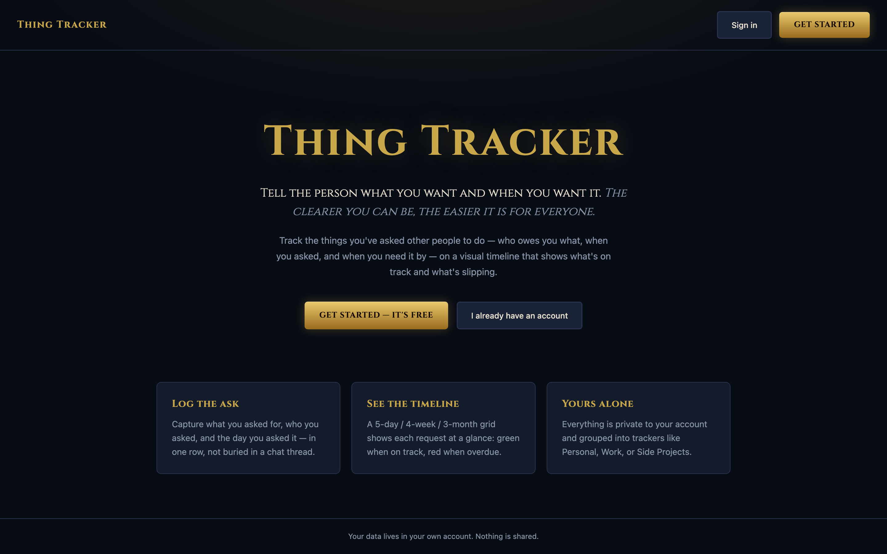

# Thing Tracker

> Tell the person what you want and when you want it. The clearer you can be, the easier it is for everyone.

Thing Tracker keeps track of the things you've asked other people to do. Instead of losing requests in chat threads, email, or memory, you log each one in a single place: what you asked for, who you asked, when you asked, and when you need it by.

Each request is a row with a visual timeline of 12 cells: 5 days, 4 weeks, and 3 months from the day you asked. Click a cell to set the due date. As time passes the cells fill in, so you can see at a glance what's on track and what's overdue:

- **Green**: time elapsed, still within the due date
- **Red**: due date has passed
- **Empty**: time hasn't elapsed yet
- **Dashed**: request is done
- **Circle**: the due date

Requests are grouped into named trackers (e.g. Personal, Work) and can be filtered by Open, Closed, or All. Descriptions and names are edited inline, and each user signs in to see only their own requests.
